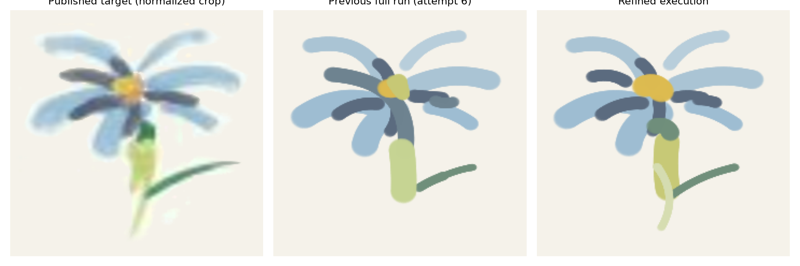
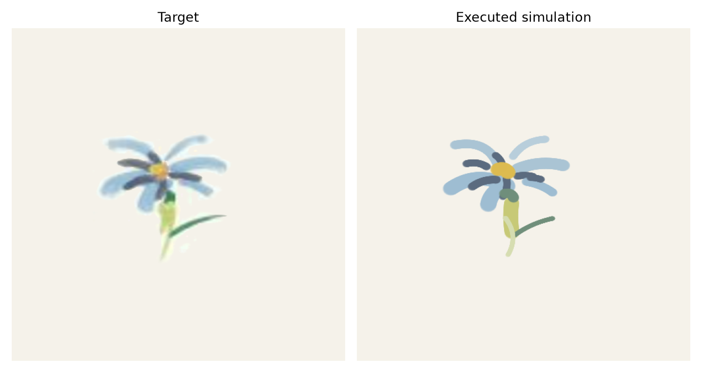
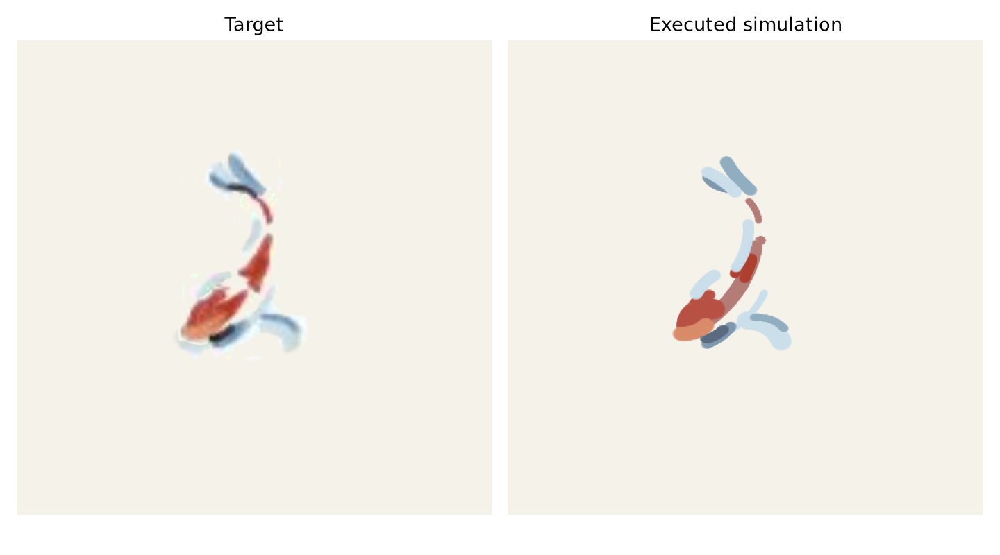

# IMPASTO: Personal Reproduction

<p align="center">
  <strong>Integrating Model-Based Planning with Learned Dynamics Models for Robotic Oil Painting Reproduction</strong><br>
  <em>Independent local simulation reproduction · arXiv:2603.29315v1</em>
</p>

> **This repository is an independent personal reproduction of IMPASTO. It is not the original authors’ code, official implementation, or an affiliated release.** The paper's official code, real self-play data, original per-stroke actions, full CAD, and trained weights were not publicly available at the time of reproduction.

<p align="center">
  <a href="reports/final_reproduction/index.html">📖 Final three-stage report</a> ·
  <a href="reports/baseline_1107014_corrected_final/showcase/painting_process_2x.mp4">🎬 2× continuous painting showcase</a> ·
  <a href="https://arxiv.org/abs/2603.29315">📄 Paper</a>
</p>



## What is reproduced

This project follows the paper's three implementation layers in a fast, parallelizable MuJoCo simulation:

1. **Environment and execution** — Franka Emika Panda, an 18×21 inch canvas, a 24-slot palette, washing station, short brush assembly, top-view camera, contact-driven paint deposition, and closed-loop normal-force control.
2. **Learned dynamics** — 1,000 simulator self-play transitions, a 900/100 episode-held-out split, and the paper-style action-conditioned U-Net training protocol.
3. **Painting and planning** — single-stroke planning plus Flower/Fish receding-horizon MPC with `H=5`, two executed strokes per replan, PCA–RANSAC initialization, elite softmax sequence updates, and CMA-style adaptation.

The final published result is the **corrected 1107014 baseline**. It fixes a confirmed diagnostic provenance bug while keeping the 1107014 painting actions and images pixel-identical. Later generic Stage-3 planning experiments were removed from the final solution because they did not produce a reliable visual improvement.

No paper baseline is implemented or evaluated, by project scope.

## Final results

| Stage | Result |
|---|---:|
| Stage 1 force RMSE | 0.0166 N at a 0.6 N target |
| Stage 1 contact success | 9/9 strokes, 1.000 contact fraction |
| Stage 1 speed | 9.28× simulation realtime without rendering |
| Stage 2 data | 1,000 transitions; 900 train / 100 validation |
| Stage 2 validation L1 | 0.008487 |
| Flower | 17/17 strokes; weighted gray L1 0.014945 |
| Fish | 18/18 strokes; weighted gray L1 0.014755 |

The result-image hashes are recorded in [`reports/final_reproduction/metrics.json`](reports/final_reproduction/metrics.json). The Stage-2 checkpoint hash is also recorded in [`reports/stage2_refined/report.md`](reports/stage2_refined/report.md).

## Gallery and video

| Flower target | Flower result |
|---|---|
|  |  |

| Fish target | Fish result |
|---|---|
|  |  |

- [2× Flower painting](reports/baseline_1107014_corrected_final/showcase/flower_painting_2x.mp4)
- [2× Fish painting](reports/baseline_1107014_corrected_final/showcase/fish_painting_2x.mp4)
- [2× Flower → Fish complete showcase](reports/baseline_1107014_corrected_final/showcase/painting_process_2x.mp4)
- [2× single-stroke experiment](reports/baseline_1107014_corrected_final/showcase/single_stroke_2x.mp4)

For the full visual report with round-by-round montages, numerical tables, caveats, and embedded video, open [`reports/final_reproduction/index.html`](reports/final_reproduction/index.html).

## Quick start

Create the isolated Conda environment:

```bash
conda env create --prefix ./.conda --file environment.yml
conda activate "$PWD/.conda"
```

Run the test suite through the project wrapper:

```bash
bash scripts/run.sh -m pytest -q
```

The wrapper keeps the environment isolated from unrelated system `PYTHONPATH` entries.

To reproduce the stages from scratch:

```bash
# Stage 1: build the scene, execute validation strokes, and write its report
bash scripts/run.sh scripts/run_stage1.py

# Stage 2: collect the paper-sized self-play set and train the U-Net
IMPASTO_STAGE2_CONFIG=configs/stage2_refined.json \
  bash scripts/run.sh scripts/collect_selfplay.py
IMPASTO_STAGE2_CONFIG=configs/stage2_refined.json \
  bash scripts/run.sh scripts/train_dynamics.py

# Stage 3: run the final corrected 1107014 configuration
IMPASTO_STAGE3_CONFIG=configs/stage3_baseline_1107014_final.json \
  bash scripts/run.sh scripts/run_stage3.py
```

The final report and showcase already contain the completed run, so opening the report does not require retraining or rerunning Stage 3.

## Repository map

- [`papers/`](papers/) — locally archived paper, appendix, extracted text, sources, and checksums.
- [`docs/reproduction_plan.md`](docs/reproduction_plan.md) — four-stage reproduction plan.
- [`docs/fidelity.md`](docs/fidelity.md) — paper alignment matrix and local assumptions.
- [`configs/`](configs/) — stage configurations, including the final corrected baseline.
- [`src/impasto/`](src/impasto/) — simulator, paint deposition, dynamics model, and planner.
- [`tests/`](tests/) — contact, dynamics, reproducibility, and planner tests.
- [`reports/scene_audit/`](reports/scene_audit/) — Stage 1 scene and force-control audit.
- [`reports/stage2_refined/`](reports/stage2_refined/) — Stage 2 training and validation artifacts.
- [`reports/baseline_1107014_corrected_final/`](reports/baseline_1107014_corrected_final/) — final Flower/Fish outputs, per-round images, metrics, and showcase videos.
- [`reports/final_reproduction/`](reports/final_reproduction/) — polished three-stage report in Markdown, HTML, and JSON.

Large generated datasets and checkpoints are intentionally kept outside Git through `.gitignore`. The verified Stage-2 dataset and checkpoint are distributed as the [`v0.1.0-reproduction-assets`](https://github.com/Magic-Pony/IMPASTO/releases/tag/v0.1.0-reproduction-assets) release asset; extract it at the repository root to restore the `data/stage2_refined/` and `outputs/stage2_refined/` paths. Their SHA-256 values remain recorded in the reports. The public repository is meant to document and reproduce the method locally, not to imply access to the authors' private data or implementation.

To restore the ignored Stage-2 artifacts with GitHub CLI:

```bash
gh release download v0.1.0-reproduction-assets \
  --repo Magic-Pony/IMPASTO \
  --pattern impasto_stage2_refined_assets.tar.gz \
  --dir /tmp/impasto-assets
tar -xzf /tmp/impasto-assets/impasto_stage2_refined_assets.tar.gz
```

## License and attribution

This repository contains an independent implementation. Upstream Panda assets retain their upstream license; see [`assets/`](assets/) and the included notices. Cite the paper when referring to the method:

```bibtex
@article{wang2026impasto,
  author  = {Wang, Yingke and Li, Hao and Zhu, Yifeng and Yu, Hong-Xing and Goldberg, Ken and Fei-Fei, Li and Wu, Jiajun and Li, Yunzhu and Zhang, Ruohan},
  title   = {IMPASTO: Integrating Model-Based Planning with Learned Dynamics Models for Robotic Oil Painting Reproduction},
  journal = {arXiv preprint arXiv:2603.29315},
  year    = {2026}
}
```
