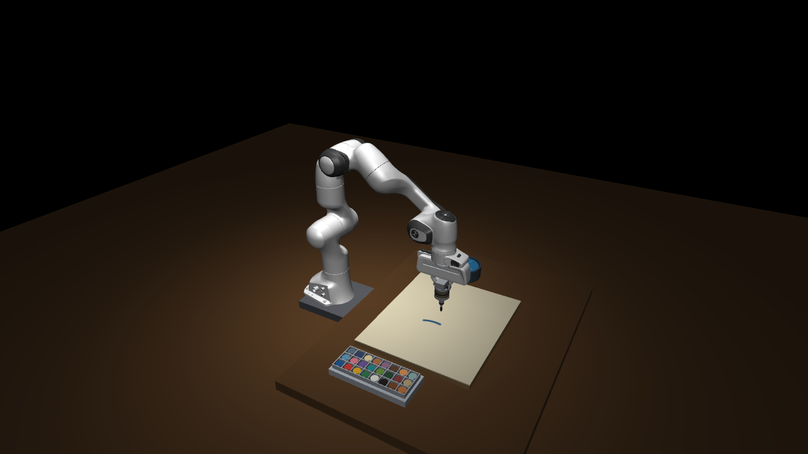
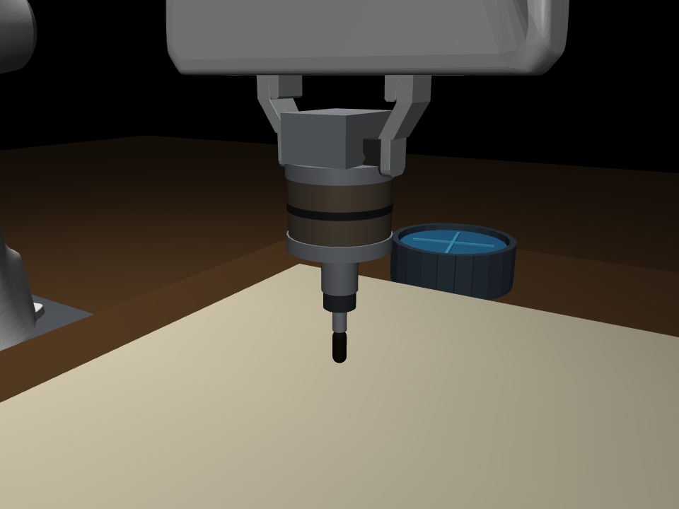
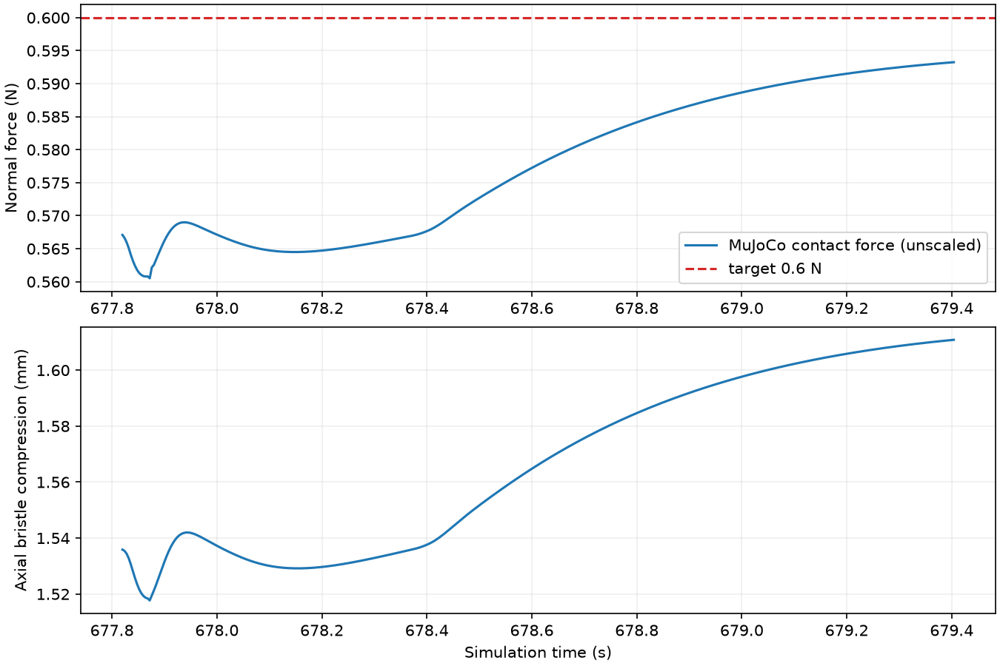
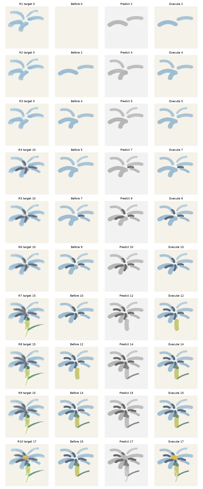

# IMPASTO 本地复现：最终三阶段报告

> **复现声明** 这是依据论文完成的个人独立复现，属于研究与工程验证项目。仓库不是原作者代码、不是官方实现，也不代表原作者或其机构。本文使用的仿真器、自探索数据、训练权重和逐笔动作均由本项目独立生成或推断。

## 结论与最终版本

最终保留的是 **1107014 corrected baseline**：只修复了一个确定的诊断错误，即在过滤和补齐候选笔画后保持 seed mask 与实际可执行动作同步；绘画动作、执行轨迹和最终画面沿用 1107014。后续通用 Stage 3 笔画规划优化已从最终版本移除，因为视觉效果没有稳定提升。

Flower 和 Fish 的最终图像分别与原始 1107014 结果逐像素一致，哈希为：

| 结果 | SHA-256 |
|---|---|
| Flower | `39eaea974389a26ee7bd22cb7ade938d247d97df0630650f5ad1d6392ca17b65` |
| Fish | `e524d3d1c61a154684a28eb0fea1bdab4d72a084dcad3470807d0c4d8373b4db` |

论文原文、附录和下载来源保存在 [`papers/`](../../papers/)；本次最终配置是 [`configs/stage3_baseline_1107014_final.json`](../../configs/stage3_baseline_1107014_final.json)。论文没有公开原作者的高分辨率逐笔动作标注和训练数据，因此 Flower/Fish 使用论文公开 Fig. 8 的目标裁剪，动作由本地规划器推断。

## 阶段 1：仿真环境、接触和绘画执行

场景使用 MuJoCo 中的 Franka Emika Panda、18×21 inch 画布、24 个预混颜料槽、清洗器、短画笔安装结构和顶视相机。论文只给出了画笔装配的功能结构，没有公开完整 CAD 尺寸；画笔长度、安装件尺寸、工位世界坐标和材料参数在本地配置中作了可审计的工程估计。

法向力控制采用关节伺服内环和实时接触力反馈的法向导纳外环；刷毛用轴向柔顺模型表示。颜料状态每个控制步依据实际笔尖位置、实际接触力、移动距离和载漆状态更新，画布纹理随运笔实时更新。这里是可并行的快速仿真，水盆没有进行流体求解，颜料沉积也不是真实油画流变模型。

| 指标 | 结果 |
|---|---:|
| MuJoCo timestep / 控制周期 | 2 ms / 4 ms |
| 画布分辨率 | 512×512 |
| 目标法向力 | 0.6 N |
| 单笔力 RMSE | 0.0166 N |
| 单笔接触比例 | 1.000 |
| 静态工位最大位置误差 | 0.0488 mm |
| 动态取色/清洗访问 | 48 次，全部成功 |
| 单笔 + 多笔验收 | 9/9 成功 |
| 无渲染仿真实时倍率 | 9.28× |
| 4 进程吞吐 / 加速比 | 2.92 笔/s / 3.53× |







完整的工位、取色清洗和力控验收见 [`reports/scene_audit/report.md`](../scene_audit/report.md)。阶段 1 的场景视频和顶视视频见 [`reports/stage1/videos/`](../stage1/videos/)。

## 阶段 2：前向动力学模型学习

按照论文报告的训练规模，采集 10 个 episode、共 1,000 条模拟 self-play transition，按 episode 划分为 900 条训练样本和 100 条验证样本，避免相邻时间步泄漏到两侧。模型是带动作嵌入的 U-Net，输入为 100×100 的双通道局部图像和 6D 笔画动作，输出下一时刻灰度局部图像。

训练采用 Adam、学习率 5×10⁻⁴、weight decay 10⁻³、batch size 120、1,000 epochs，每 100 epochs 将学习率乘 0.75；最佳 checkpoint 出现在 epoch 236。网络参数量为 999,361，通道宽度为 `[32, 64, 128, 256]`。

| 指标 | 结果 |
|---|---:|
| self-play / train / validation | 1000 / 900 / 100 |
| 最佳 epoch | 236 |
| validation unweighted L1 | 0.008487 |
| changed-region L1 | 0.028098 |
| background L1 | 0.005210 |
| 论文报告参考值 | 0.0285 |
| checkpoint SHA-256 | `831ea440fd73c275e350e65cca236598b5aff4b5a1b4ba74a646a58744799d35` |

这个数值低于论文参考值，但两者来自不同的仿真/真实数据分布，不能解释为严格的跨数据集优越性。训练和评估的完整记录见 [`reports/stage2_refined/report.md`](../stage2_refined/report.md)。


## 阶段 3：模型预测规划与闭环绘画

单笔实验使用 `H=1`。Flower/Fish 使用论文式 `H=5` 预测窗口，每次执行两笔后读取当前画布并重新规划。初始化采用 PCA–RANSAC 笔画候选，候选序列通过 elite softmax 的 MPPI 风格更新，再用 CMA 风格协方差自适应收缩搜索分布。颜色在本地 24 色 palette 中选择；论文提到的实测颜料 patch 数据库和原始逐笔 action 未公开，因此本地使用目标 RGB 与预混 palette 的颜色匹配。

本项目没有复现论文中的 FRIDA-CNN、IMPASTO-LR 和 Heuristics-only baseline，符合本复现任务“不复现 baseline”的范围。

### 单笔

单笔结果的 weighted gray L1 为 0.000931，力 RMSE 为 0.01035 N，轨迹 RMSE 为 0.0654 mm。结果和视频见 [`baseline_1107014_corrected_final/`](../baseline_1107014_corrected_final/)。

### Flower

| 指标 | 结果 |
|---|---:|
| 目标 / 执行笔数 | 17 / 17 |
| 重规划轮数 | 10 |
| weighted gray L1 | 0.014945 |
| changed-region gray L1 | 0.062027 |
| MPC 预测–执行 L1 | 0.000363 |
| 法向力 RMSE | 0.00843 N |
| 轨迹 RMSE | 0.1137 mm |
| 最终画面 SHA-256 | `39eaea974389a26ee7bd22cb7ade938d247d97df0630650f5ad1d6392ca17b65` |

<div class="gallery">


</div>



### Fish

| 指标 | 结果 |
|---|---:|
| 目标 / 执行笔数 | 18 / 18 |
| 重规划轮数 | 11 |
| weighted gray L1 | 0.014755 |
| changed-region gray L1 | 0.079547 |
| MPC 预测–执行 L1 | 0.000312 |
| 法向力 RMSE | 0.02453 N |
| 轨迹 RMSE | 0.1197 mm |
| 最终画面 SHA-256 | `e524d3d1c61a154684a28eb0fea1bdab4d72a084dcad3470807d0c4d8373b4db` |

<div class="gallery">


</div>


## 完整绘画过程视频

视频按仿真时间生成，并以 2× 播放速度导出。合集按 Flower → Fish 顺序展示，另提供单独视频。

- [2× 完整绘画合集](../baseline_1107014_corrected_final/showcase/painting_process_2x.mp4)
- [2× Flower](../baseline_1107014_corrected_final/showcase/flower_painting_2x.mp4)
- [2× Fish](../baseline_1107014_corrected_final/showcase/fish_painting_2x.mp4)
- [2× 单笔](../baseline_1107014_corrected_final/showcase/single_stroke_2x.mp4)

## 论文对齐点与边界

已对齐或尽量对齐的内容包括 Panda 机器人、18×21 inch 画布、24 色槽、短笔和安装结构的拓扑、二次 Bézier 笔画参数、实时接触驱动的画布更新、1000 条 self-play / 900 条训练数据、U-Net 结构与训练超参数、`H=5`、每轮执行两笔、PCA–RANSAC 初始化、MPPI 风格 elite 更新和 CMA 风格自适应。

论文没有充分公开的部分包括完整 CAD、真实机器人/画笔材料参数、真实 self-play 数据、逐笔动作标注、颜料 patch 数据库、完整 MPC 超参数和官方代码。相应的本地估计全部保留在配置和报告中。阶段 1 与阶段 2 的指标用于验证本地实现；阶段 3 的图像差异主要反映逐笔分解、颜色和局部沉积模型的替代误差。

## 复现命令

```bash
conda env create --prefix ./.conda --file environment.yml
conda activate /home/lcy-pony/Draw_WS/IMPASTO/.conda

# 代码检查
bash scripts/run.sh -m pytest -q

# 阶段 1（生成场景和验收报告）
bash scripts/run.sh scripts/run_stage1.py

# 阶段 2（如需从头复现；本最终展示直接使用已验证 checkpoint）
IMPASTO_STAGE2_CONFIG=configs/stage2_refined.json \
  bash scripts/run.sh scripts/collect_selfplay.py
IMPASTO_STAGE2_CONFIG=configs/stage2_refined.json \
  bash scripts/run.sh scripts/train_dynamics.py

# 阶段 3（最终 corrected baseline；会重新生成输出）
IMPASTO_STAGE3_CONFIG=configs/stage3_baseline_1107014_final.json \
  bash scripts/run.sh scripts/run_stage3.py
```

最终提交只包含最终 corrected baseline 的展示视频、报告入口、配置和必要的代码回退；历史优化实验目录留在本地工作区，未作为最终方案发布。
