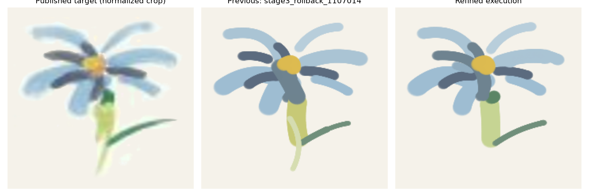
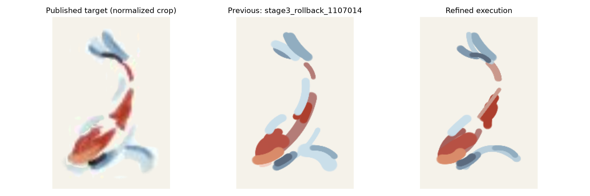

# IMPASTO：选择性回退与通用修正

这轮完成了以1107014为基础的选择性回退、通用物理/模型/规划修正及完整对照。随机新种子测试支持平均改进，但艺术目标仍有漏笔和形状偏差，不能称已经达到令人满意的油画复现效果。预测与执行接近并不意味着预测符合目标；下文把三者分开核查。尤其Fish的前景IoU由0.7279降至0.6208、召回由0.7664降至0.6351，平均颜色误差的改善伴随明显覆盖退化；因此本轮作为可审查的通用改进候选归档，不能认定已经全面优于1107014。

[完整图片、逐轮RGB审计与连续视频](index.html)

|任务|1107014 L1|候选v4 L1|校准对照L1|本轮L1|相对降幅|IoU|召回|RGB L1|
|---|---:|---:|---:|---:|---:|---:|---:|---:|
|flower|0.014841|0.014236|0.014210|0.014009|5.61%|0.765|0.785|0.0687|
|fish|0.014842|0.013654|0.013960|0.013578|8.52%|0.621|0.635|0.0841|

|任务|旧IoU|本轮IoU|旧召回|本轮召回|旧RGB L1|本轮RGB L1|
|---|---:|---:|---:|---:|---:|---:|
|flower|0.7613|0.7647|0.7795|0.7854|0.07254|0.06867|
|fish|0.7279|0.6208|0.7664|0.6351|0.09182|0.08412|

Fish平均误差下降，但IoU和召回明显退化，不能称视觉全面改善。单笔闭环L1从0.0009305升至0.0011227，退化20.65%。

## 修改与归类

- **选择性回退**：保留 1107014 的对称灰度目标、RGB 权重 1、原宽度/沉积律；弃用 force cap 和过度压窄约束；统一使用全部 24 色。 本地版本选择；删除按任务限制颜色的做法。
- **阶段一**：MuJoCo 刷尖接触松弛时间 6→20ms；2ms timestep、刷毛弹簧和持续力反馈不变。随机动作证明原低力振荡。 仿真数值修复；不是论文参数，也没有证明论文控制公式有误。
- **阶段二**：2000 条随机 self-play，1800/200 按 episode 划分；提高低压力采样比例；拒收断触/大力误差。保持 UNet、Adam、batch120、1000epochs 和学习率衰减。 通用扩展；超过论文 900/100 的数据预算。
- **BatchNorm**：按网络前向顺序，仅用未增强训练集重估 BN 总体统计；关闭 dropout，不改权重、不做梯度更新。 通用部署校准；论文未规定；原始新模型并非全面改善。
- **候选提取**：保留细线连通区域；RGB 已识别区域不再被第二次灰度门限丢弃；PCA/RANSAC 增加颜色区域和多力假设；用 learned dynamics 排序。 本地预处理修复和通用候选扩展。
- **颜色采样**：足迹与中心圆盘交集、距离加权、线性 RGB 均值、Mahalanobis 分类；中心圆盘半径统一 15mm。 更对齐 Appendix B；15mm 是本地数值；72组随机分类测试两种方法均100%。
- **颜料可行性**：预测灰度限制在当前灰度与颜料灰度之间，防止虚构擦除或亮度越界；空间变化仍来自学习模型。 依据本地凸混合沉积不变量的通用扩展；不是论文原算法。
- **等灰度覆盖**：用同一学习模型对空白参考做反事实预测，估计覆盖率，补足灰度近似相同、色相不同的换色区域。 通用 RGB 预测修复；无解析真值、无目标动作输入。
- **顺序搜索**：H≤5 时枚举最多120个种子排列，用同一模型和目标代价选覆盖顺序，再正常进行 MPPI。 通用规划扩展；论文未明确采用。
- **运行速度与追溯**：预渲染 disk stamp 改为最近采样点查询，200随机动作逐像素相同，局部函数快3.10倍；保存配置、源码和模型哈希。 工程优化；没有减少规划候选或迭代预算。

## 开发集（三笔）

5/8加权灰度误差改善。

- weighted_gray_l1：0.001695 → 0.001481，下降 12.65%。
- changed_region_gray_l1：0.038732 → 0.033154，下降 14.40%。

## 新种子测试（四笔）

6/8加权灰度误差改善。

- weighted_gray_l1：0.002856 → 0.002423，下降 15.16%。
- changed_region_gray_l1：0.051533 → 0.046805，下降 9.17%。

新种子四笔目标有6/8加权灰度改善，均值下降15.16%，前景并集RGB误差下降14.32%，IoU均值0.7584→0.8017。肉眼也确认case5的浅粉交叉笔从遗漏变为可见；case6仍漏浅粉笔，case3右上绿弧仍偏短，case0/2灰度略退化。样本仅8幅、目标来自本地仿真，不能据此保证任意艺术照片。开发三笔目标的5/8改善与新测试分开呈现；两画未采用专用颜色、位置、轮次或动作。

## 用户现象的核查

- **Flower首轮左笔与目标不符**：原观察有依据，但需要区分H笔终态和已经执行的前两笔。新版首轮先画右上细浅蓝及右中浅蓝，左上浅蓝在第2轮执行、左下浅蓝在第3轮执行。首轮H终态中的左笔仍等宽、圆头，不能表达图版里的变宽和浓淡。其大体中心线来自PCA/RANSAC，执行接近预测；主要是候选几何/动作与沉积表达限制，并非执行把准确预测画坏。
- **Flower第四轮首笔不准**：新版第4轮首笔是左下深蓝内瓣，中心线位于目标深色区域，预测/执行接近；端部仍圆、色调和宽度不完全匹配目标。第5轮中央向下深笔的色调也偏灰。颜色足迹采样和模型校准改善部分问题，但不能据此认定全部笔迹恢复。
- **Flower第七轮粗绿笔替代两个细笔**：目标包含宽浅黄绿底色、顶部短深绿和右伸细绿，不能把宽底色直接删掉。新版第7轮的H=5计划包含这三类区域，前两笔执行宽底色和短绿；短绿仍变成圆点。右伸细绿第9轮执行，其颜色与弧线较合理。底部极淡细茎没有被选入最终动作，反而是1107014保留得更好。原问题部分改善，未彻底解决。
- **Fish首轮出现过长笔迹**：用户截图中的长红笔确实把中部与下部两个分开的红区串起来了。新版第1轮先画中部红色小弧，再同区细长补笔；没有横跨空白连接两个红区。预测和执行一致，但中红区仍过圆、末端凸出，且两笔花在同一区域。中心线连续/颜色支持检查改善跨空白候选，多笔分解与笔数分配仍不完善。
- **Fish头部浅蓝与尾部深蓝遗漏**：按图中位置区分：新版第10轮补了顶部两片蓝色之间的深蓝短弧，也加深下部红色椭圆右下方蓝笔；第11轮补出该红色椭圆上方浅蓝，但优化后过直、偏长，色调过于均匀。中部红色区域左上侧另一片淡蓝仍漏，下部最右蓝色弧缺少向下转折。这些位置在相应H计划和已执行前缀里本就缺失，不能归因于机器人把正确预测漏执行。选中候选/颜色/代价排序与有限笔数是主要嫌疑；所展示掩码并非完整候选池，不能断言PCA从未提出这些区域。

## Flower逐轮视觉审计

1. 0→2笔，目标为第5笔图版。PCA/RANSAC提出五片浅蓝区域；顺序搜索先执行右上细弧和右中较宽弧。逐笔RGB预测和真实执行位置、宽度总体接近，主要差异在边缘。H终态中的左上弧仍为等宽圆头，与目标左端较宽、向中心收细的外观有差距；这是几何/沉积表达偏差，不能把尚未执行的左笔当成执行失败。

   [八图](audit/flower_audit_01.png) · [RGB逐笔预测](audit/flower_rgb_rollout_01.png)

2. 2→4笔。先画朝下的浅蓝瓣，再画左上浅蓝弧；区域和中心线方向合理，预测与执行一致。左上弧的中心端过圆、左端未恢复目标浓淡；下瓣与周围浅蓝在此时仍分离。模型边缘模糊和恒力恒色动作限制同时存在。

   [八图](audit/flower_audit_02.png) · [RGB逐笔预测](audit/flower_rgb_rollout_02.png)

3. 4→5笔，仅补左下浅蓝弧。PCA区域连着朝下花瓣，但拟合路径落在左下横弧；优化后实际形成两瓣相交的形状。预测和执行大体一致，实际边缘比预测锐利。目标左下片更有变宽和淡边，当前均匀笔迹无法完整表达。

   [八图](audit/flower_audit_03.png) · [RGB逐笔预测](audit/flower_rgb_rollout_03.png)

4. 5→7笔，切换到第10笔目标。新增左下深蓝内瓣和右下浅蓝外瓣。候选覆盖对应区域，首笔未再跨过中心形成长深笔。RGB前缀与执行接近；深笔仍偏圆且较短，不能把低预测/执行误差解释成与目标完全相符。

   [八图](audit/flower_audit_04.png) · [RGB逐笔预测](audit/flower_rgb_rollout_04.png)

5. 7→9笔。画中央向下深灰蓝弧及右侧深蓝内瓣；中心线位置合理、没有明显机器人轨迹偏移。中央深笔色调较目标偏灰，模型预测边界较软；几何、颜色离散化及模型误差都参与，不能单归因力控。

   [八图](audit/flower_audit_05.png) · [RGB逐笔预测](audit/flower_rgb_rollout_05.png)

6. 9→10笔。补左上朝中心的短深灰蓝弧，位置接近目标深色内段，预测与实际相近。目标短笔尖端和纵向深浅变化未恢复，当前圆头恒宽仍明显。

   [八图](audit/flower_audit_06.png) · [RGB逐笔预测](audit/flower_rgb_rollout_06.png)

7. 10→12笔，切换到第15笔目标。候选包括宽浅黄绿底色、顶部短绿、上侧深色和右伸细叶；首两笔为宽底色及短绿。RGB预测存在少量覆盖到邻近浅蓝的浅色伪影，实际较干净。短绿虽然没有被丢弃，却成圆点；H终态里细叶可见但此次尚未执行。目标中的宽底色确实存在，问题是宽度/浓淡和短绿形状，而不是应删除这一笔。

   [八图](audit/flower_audit_07.png) · [RGB逐笔预测](audit/flower_rgb_rollout_07.png)

8. 12→14笔。首笔在中心左侧补了一小段浅蓝，第二笔以较长深灰蓝弧连接左上内瓣与向下中心段。长候选把相邻深色区域合并，造成中心灰蓝部分偏厚；连续支持检查不能区分同色、相邻且无空白间隙的多个画家笔迹。模型和执行均出现同样趋势，这是候选分解及笔数分配问题，不是力控把短笔拉长。

   [八图](audit/flower_audit_08.png) · [RGB逐笔预测](audit/flower_rgb_rollout_08.png)

9. 14→15笔。补右伸细绿叶，候选、优化中心线与目标弧线较一致，预测/执行也接近；恒力圆头仍不能恢复目标右端尖细和深浅变化。比原来的末轮随意补叶更合理，但底部极淡细茎仍没有进入本轮最终选中种子/动作。

   [八图](audit/flower_audit_09.png) · [RGB逐笔预测](audit/flower_rgb_rollout_09.png)

10. 15→17笔，切换最终目标。先画黄色花心，再补右中浅蓝瓣；花心预测有覆盖不均，实际接近实心圆，右瓣发生再次加宽。最终右叶可见、中心较1107014收窄，但底部极淡细茎遗漏、顶部短绿仍圆、各瓣仍等宽。剩余两笔被花心与较高面积收益的浅蓝区域占用，体现薄弱细节候选/代价排序与有限笔数的问题；不能称最终画面全面胜过1107014。

   [八图](audit/flower_audit_10.png) · [RGB逐笔预测](audit/flower_rgb_rollout_10.png)

[连续仿真视频](flower_scene_replay.mp4)

## Fish逐轮视觉审计

1. 0→2笔，目标为第5笔图版。先画中部红色短粗弧，再在同一区域补细长红笔；预测与真实执行接近，没有再跨过中下红区之间的空白画长桥。H终态包含下方红色区域的轮廓与填充，但此次未执行。中红区仍比目标圆，右下末端凸出；两笔集中同区也降低了笔数使用效率。主要剩余偏差在候选几何/动作选择，而非执行位移。

   [八图](audit/fish_audit_01.png) · [RGB逐笔预测](audit/fish_rgb_rollout_01.png)

2. 2→4笔。两笔窄玫红弧描出下方红色椭圆的边缘，预测/执行位置与宽度接近。候选落在目标红区，没有跨空白；然而两条边缘笔留下大块空心，仍需下一轮宽笔填充。H计划中的填充尚未执行，不能把中间结果当作完整预测终态。笔数分配和目标区域的笔迹分解仍欠佳。

   [八图](audit/fish_audit_02.png) · [RGB逐笔预测](audit/fish_rgb_rollout_02.png)

3. 4→5笔。宽红斜弧填充下方椭圆，预测与执行一致；真实边缘较锐利。目标呈不规则浓淡与局部尖端，当前形成粗圆头、均匀色块。顶部红短弧还未画，属于下一检查点中的后续动作。恒力恒色动作及局部混合沉积是这一轮主要视觉限制。

   [八图](audit/fish_audit_03.png) · [RGB逐笔预测](audit/fish_rgb_rollout_03.png)

4. 5→7笔，切换第10笔目标。新增下方红区底端橙色短弧和顶部红短弧。橙边预测出现少量重影/斑纹，实际更实；顶部红笔的中心线与目标接近。H终态含顶部蓝两笔，但中部淡蓝与下方蓝转折没有进入此次选中动作。颜色与种子排序对低对比细节仍不友好。

   [八图](audit/fish_audit_04.png) · [RGB逐笔预测](audit/fish_rgb_rollout_04.png)

5. 7→9笔。画顶部左短灰蓝弧和右长浅蓝弧，位置合理，预测/执行接近。目标蓝笔的尖端、局部浓淡没有恢复，实际仍等宽圆头。H第三笔是中红区浅粉小补笔，未执行；这并不能补上目标中部淡蓝。灰度与RGB代价的综合排序仍选择了面积更大的均匀笔。

   [八图](audit/fish_audit_05.png) · [RGB逐笔预测](audit/fish_rgb_rollout_05.png)

6. 9→10笔。种子为中红区很短的粉色笔，优化后变成沿红区左缘较长的浅粉斜线；实际接近预测。该颜色和形状均不理想，是优化动作本就与目标不匹配；并非准确的浅蓝预测被机器人画成了粉色。候选/颜色选择及综合代价仍有问题。

   [八图](audit/fish_audit_06.png) · [RGB逐笔预测](audit/fish_rgb_rollout_06.png)

7. 10→12笔，切换第15笔目标。画下方右伸浅蓝长弧和下方左侧灰蓝短弧，预测有轻微旧红区patch伪影，实际较干净。H里还有右侧浅蓝向下片，此次未执行。下方目标蓝色形状被表达成两条线，中间连接和变宽不足；动作表达与执行顺序都有影响。

   [八图](audit/fish_audit_07.png) · [RGB逐笔预测](audit/fish_rgb_rollout_07.png)

8. 12→14笔。先补下方右弧上缘灰蓝短笔，再重复顶部红区的浅粉补笔。后者变宽变淡，与目标深红更不符；预测/执行都出现该趋势，说明不是轨迹或力控失误。H第三笔是顶部蓝的重复补笔，未执行。重复高面积笔迹占用有限预算，低对比浅蓝细节继续遗漏。

   [八图](audit/fish_audit_08.png) · [RGB逐笔预测](audit/fish_rgb_rollout_08.png)

9. 14→15笔。在顶部右长蓝瓣左沿补浅蓝弧；预测/执行接近，出现一条较亮的边缘，但目标的不规则宽度与浓淡仍未恢复。此笔没有解决中部淡蓝缺失。大面积重叠补色依旧被优先选择，候选评分与笔数分配是剩余问题。

   [八图](audit/fish_audit_09.png) · [RGB逐笔预测](audit/fish_rgb_rollout_09.png)

10. 15→17笔，切换最终目标。先画顶部两蓝瓣之间的深灰蓝短弧，再加深下部红色椭圆右下方蓝笔；两处此前缺少的深色均变得可见，预测/执行接近。目标深色更深且有尖端，当前偏均匀灰蓝。H第三笔预测下方红区上方浅蓝，此次尚未执行；所展示H=3不是已经执行三笔。

   [八图](audit/fish_audit_10.png) · [RGB逐笔预测](audit/fish_rgb_rollout_10.png)

11. 17→18笔。补下方红色椭圆上方浅蓝，种子是一条小弧，优化却拉成斜向近直线；预测与执行接近，目标原弧更短且不规则。这说明最后一步依然有优化形状不合理的问题。最终消除了跨空白红桥、补了深蓝细节，但中部红区左上淡蓝仍漏、最右蓝弧的向下转折缺少，1107014在这两处反而保留得更好。不能以整画平均误差下降认定所有局部改善。

   [八图](audit/fish_audit_11.png) · [RGB逐笔预测](audit/fish_rgb_rollout_11.png)

[连续仿真视频](fish_scene_replay.mp4)

## 剩余限制

阶段一仍采用接触驱动的局部颜料混合，没有刷毛分辨形变、真实油漆流体、真实相机和传感器噪声；圆头、恒宽和缺少浓淡是显著的视觉限制。恒力恒色二次曲线属于保留的论文动作设计，增添时变力或复杂笔迹必须另作通用扩展验证。

阶段二增加到2000条数据并未自动让原始新模型更好。仅训练集BN校准改善部署输出，但独立两曲线×7力值的局部预测误差仍未超过旧模型；不能用整幅画平均误差掩盖这个事实。

阶段三的连续/颜色支持检查能排除跨纸面空白的错误长笔，却不能可靠区分同色相邻、相交且宽度变化的多笔。小面积低对比细节仍会被候选排序及固定笔数预算遗漏；最终画面仍有局部退化。

使用公开Fig.8裁剪作为目标；原高清艺术目标、作者动作标注和真实机器人self-play未公开。本轮没有修改目标预处理来降低误差，但预处理与图版分辨率本身会影响极淡细节。LPIPS不可用，未计算。

掩码颜色只是候选区域的显示编号，既不是颜料颜色，也不能直接推断执行先后；S编号来自实际保存的顺序搜索后的种子中心线，A编号来自优化后此次执行动作。

单笔闭环加权灰度L1从0.0009305升至0.0011227，退化20.65%；两画平均误差下降不代表每项测试都改善。Fish中部淡蓝和最右蓝弧向下转折、Flower极淡细茎仍缺失，部分重复补色反而拉低局部视觉质量。

完整1000epochs训练；校准checkpoint SHA-256：`8368f23e35705531a8f3701bbefa5fd59c98fb755f941577a562a3fd8dc2eb87`。

全图均值、局部模型误差、失败试验与校准版本详见HTML。未声称达到论文硬件效果或证明任意艺术目标均可复现。
