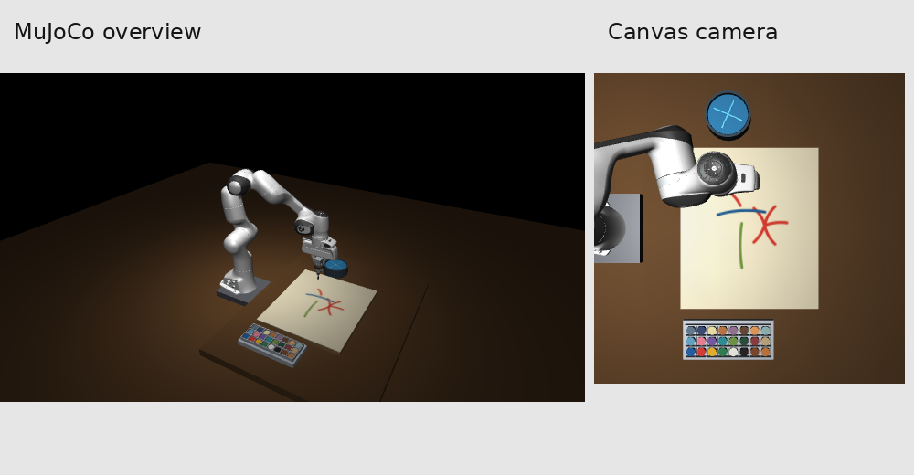
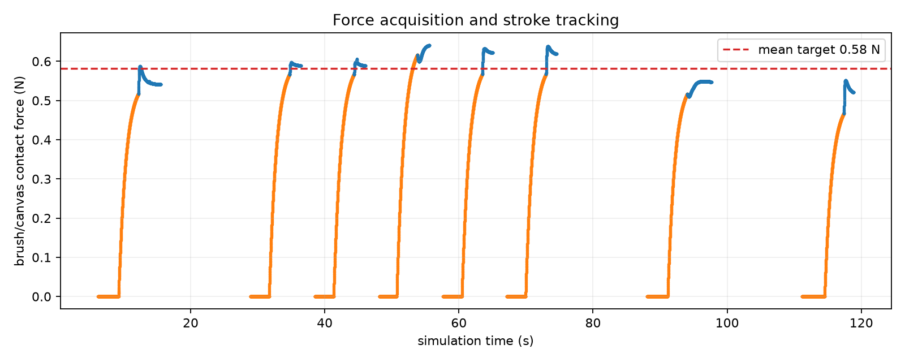
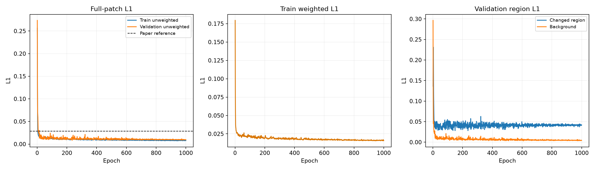
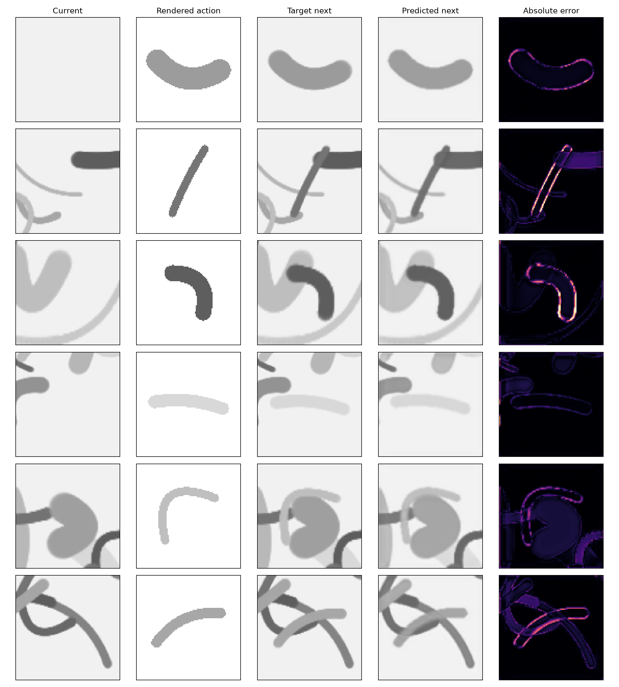
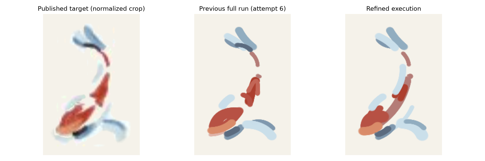
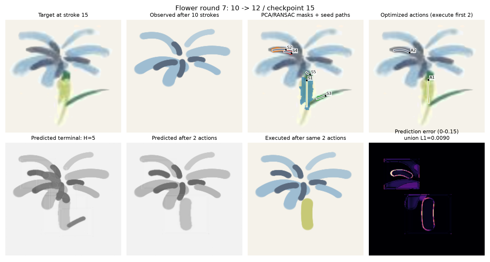
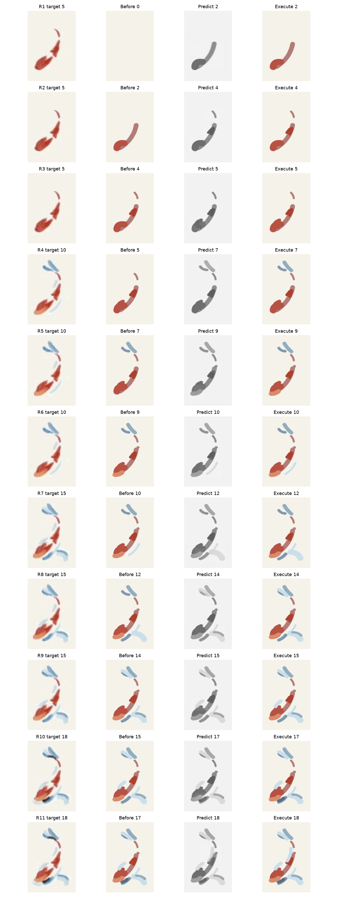

# IMPASTO 本地仿真复现：最终优化报告

日期：2026-10-10  
代码根目录：`/home/lcy-pony/Draw_WS/IMPASTO`

## 结论

本轮已经完成一次从阶段一到阶段三的闭环复查和优化，并重新检查了 Flower 的 10 轮、Fish 的 11 轮目标分解、模型预测和真实执行画面。当前结果中，MPC 预测和 MuJoCo 执行已经比较接近，主要剩余误差来自目标图像的低分辨率、PCA/RANSAC 对连续颜色区域的笔画分解、离散不透明笔画以及简化的颜料沉积模型。

这是一份 MuJoCo 本地复现，不是论文真实机器人和真实油画物理的完整复现。Flower/Fish 目标来自论文公开 Fig. 8 的 panel crop；作者没有公开原始高分辨率画作、逐笔动作标签和 25×25 实测颜料 patch 数据库。当前没有实现论文 baseline，也没有使用不存在的作者逐笔轨迹作为 oracle。

## 复现范围和最终配置

|项目|当前实现|
|---|---|
|仿真器|MuJoCo Panda，本地接触驱动画笔和画布模型|
|画布|18×21 inch，`0.4572 × 0.5334 m`，512×512 画布状态|
|工具|论文图示的夹具、F/T 外壳和短画笔结构；修剪后画笔总长按 50 mm 的工程估计|
|动作|`(x0, y0, length, bend, angle, force)`，二次 Bezier 笔画|
|颜料|24 个预混颜色，独立笔刷载漆状态；正式阶段三使用不透明任务颜料分支，`opacity_scale=1.0`|
|动力学模型|阶段二训练的 IMPASTO U-Net，输入 100×100 双通道灰度 patch 和 6D 动作|
|MPC|H=5，64 candidates，36 iterations，20% elite，每轮执行 2 笔后用实际画布重新规划|
|任务|Flower 17 笔，Fish 18 笔，单笔 H=1；不复现 baseline|
|规划目标|公开 Fig. 8 目标图和实时画布差分；`use_published_prefix_targets=false`|

阶段三的最终配置是 [configs/stage3_refined.json](../../configs/stage3_refined.json)，阶段二 checkpoint 是 `outputs/stage2_refined/impasto_unet_best.pt`。论文原文保存在 [papers/IMPASTO_arxiv_2603.29315v1.html](../../papers/IMPASTO_arxiv_2603.29315v1.html)。

## 阶段一：仿真环境和力控

### 场景修正

本轮保留了论文给出的关键拓扑：Panda、18×21 inch 画布、24 个颜料槽、清洗器、顶视相机和短画笔安装组件。针对前几轮发现的“笔太长、画笔斜着进入颜料盘、蘸水位置不方便、画布笔迹方向异常”等问题，场景做了以下修正：

- 使用夹持块、上下法兰、F/T 外壳、夹具和短画笔组成完整工具链。
- 修剪后画笔按 50 mm 建模，其中约 16 mm 插入夹具，约 34 mm 外露；木柄、金属箍和刷毛尺寸是论文未给出的本地工程估计。
- 调色盘和清洗器放在画布两侧，并以竖直进入路径访问；取色和清洗不再从不自然的斜向姿态进入。
- 画布每个仿真控制步都按实际刷尖位置、实际接触法向力、移动距离和载漆量更新。笔画不是在运笔完成后一次性贴到画布。
- 取色和清洗路径采用自由空间快速移动、平滑换位、短停留和竖直进出。相对早期版本，取色时间约减少 65.9%，清洗时间约减少 63.5%。

场景和工具的逐项审计见 [scene_audit/report.md](../scene_audit/report.md)。

### 当前力控实现

论文描述的是阻抗内环和法向力环的组合控制，并在起笔和运笔阶段采用不同策略。本地实现保留了这个阶段结构，但没有声称实现硬件控制器的完整 `J^T F_ff` 力矩注入：

1. 关节位置/姿态伺服作为 MuJoCo 内层控制器。
2. 每个控制步读取刷尖与画布的未缩放接触法向力。
3. 对力读数做 EMA 滤波；起笔阶段先到画布上方 1.5 mm，再用限速高度修正建立目标法向力。
4. 当力误差进入 ±0.04 N 并持续 0.16 s 后进入运笔。
5. 运笔过程中继续以低带宽高度反馈修正，限制垂直速度，防止接触力因离散接触和关节伺服误差漂移。

因此当前实现是“接触反馈下的实时导纳近似”，不是论文硬件控制器的逐项复刻。阶段一验收结果如下：

|指标|结果|
|---|---:|
|笔画成功率|9/9|
|接触力获取率|1.000|
|平均法向力 RMSE|0.021 N|
|运笔阶段法向力标准差|0.011 N|
|运笔阶段法向力范围|0.044 N|
|平均接触轨迹 RMSE|2.66 mm|
|平均刷杆倾角|0.009°|
|平均取色时间|4.74 s|
|平均清洗时间|3.85 s|
|串行吞吐量|0.827 stroke/s|
|4 进程并行吞吐量|2.918 stroke/s|
|并行加速比|3.53×|

这些结果说明阶段一的接触和轨迹执行已经足够稳定，当前 Flower/Fish 的主要问题不是“每一笔都没有按规划走”。但刷毛用轴向弹簧近似、沉积用局部接触模型，仍会影响笔画宽度、覆盖率和颜色混合。

## 阶段二：前向动力学模型

### 数据和训练

重新采集了 1000 条成功的 MuJoCo self-play transition：900 条训练数据，100 条按 episode 留出的验证数据。训练使用 10 个 episode，每个 episode 100 笔；episode 0--8 用于训练，episode 9 用于验证。数据覆盖短笔画、叠画、24 个预混颜色和阶段三使用的力范围。

网络与论文描述保持一致：输入为当前灰度 patch 与预渲染笔画的 100×100 双通道，输出下一状态完整灰度 patch；6D 动作经过 MLP embedding 后融合到 U-Net 的 64 通道层。训练使用加权 L1、Adam、学习率 `5e-4`、weight decay `1e-3`、batch size 120、1000 epochs，每 100 epochs 将学习率乘以 0.75。网络宽度为 `[32, 64, 128, 256]`，参数量为 999,361。

### 训练结果

|指标|结果|
|---|---:|
|最佳 epoch|236|
|全 patch validation L1|0.008487|
|变化区域 L1|0.028098|
|背景 L1|0.005210|
|变化像素平均占比|14.317%|
|训练时间|608.4 s|
|设备|NVIDIA GeForce RTX 4090 D|
|checkpoint SHA-256|`831ea440fd73c275e350e65cca236598b5aff4b5a1b4ba74a646a58744799d35`|

论文报告的 0.0285 是不同数据域上的全 patch L1 参考值，不能当作严格可比的测试集结果。本地验证集还参与了 checkpoint 选择，因此这里应称为 episode-held-out validation，而不是完全独立测试。

阶段二单步数值较好，但它没有保证长时间、多笔、目标驱动的闭环 roll-out 一定准确。Fish 第 1 轮的预测执行差异为 0.03282，明显高于 Flower 第 1 轮的 0.01129，说明多步 rollout 和目标区域形状会放大模型误差。

## 阶段三：规划、预测和执行

每轮流程是：

1. 从当前实际画布与目标差分得到变化区域。
2. 用 PCA/RANSAC 提取候选连通区域和中心线，生成初始笔画。
3. 根据目标区域颜色和本地调色板选择候选颜色。
4. 用阶段二模型对候选动作做 H 步 rollout。
5. 以加权灰度 L1 为主目标，并加入 RGB 辅助项和越界、重叠等约束进行 MPPI/CMA 风格更新。
6. 只执行前两笔，读取真实 MuJoCo 画布，再开始下一轮。

最终聚合指标：

|任务|最终 foreground IoU|目标前景召回|paint precision|目标前景 RGB L1|目标前景灰度 L1|预测执行目标区域 L1|力 RMSE|轨迹 RMSE|
|---|---:|---:|---:|---:|---:|---:|---:|---:|
|Flower|0.7579|0.7767|0.9691|0.07135|0.06509|0.00705|0.00843 N|0.114 mm|
|Fish|0.7153|0.7513|0.9372|0.08891|0.08316|0.00968|0.02453 N|0.120 mm|

这里的预测执行指标是在目标、当前画布和执行画布的 union foreground 上计算的灰度 L1；它比全画布平均值更能反映笔画是否落在目标区域。LPIPS 没有计算，因为预训练 AlexNet 权重校验未通过，不能用随机权重制造该指标。

### Flower 逐轮诊断

下表中的“预测误差”是预测执行 union gray L1；IoU、召回和 RGB L1 是执行后相对于该轮公开 checkpoint 目标的区域指标。每轮图像按 `目标 / 实际观测 / PCA-RANSAC 种子 / MPC 前两笔 / H 步预测 / 执行结果 / 预测误差` 排列，见 `flower_audit_01.png` 到 `flower_audit_10.png`。

|轮次|执行范围|H|颜色槽|预测误差|执行后 IoU|视觉诊断|
|---:|---:|---:|---|---:|---:|---|
|1|0→2|5|13,14|0.01129|0.425|从空白开始先补两条蓝色花瓣，方向和位置合理；预测灰度比真实颜色更粗，属于颜色显示差异，不是轨迹失控。|
|2|2→4|3|14,13|0.01057|0.670|继续补外侧和下侧花瓣，执行和预测高度重合；目标还包含未执行的第 5 笔，因此 IoU 尚未达到目标。|
|3|4→5|1|18|0.00399|0.755|单笔收敛最好，剩余花瓣中心结构被补齐；预测和执行几乎一致，阶段一执行误差不是主因。|
|4|5→7|5|1,13|0.00772|0.731|切换到 10 笔 checkpoint 后，目标差分包含深色花心/花瓣区域；两笔执行使 IoU 暂时下降，但总体结构仍正确。|
|5|7→9|3|1,1|0.00819|0.754|深色花瓣和花心继续补齐，实际笔迹沿预测位置落下；离散笔画带来的覆盖边缘比目标更硬。|
|6|9→10|1|1|0.00687|0.766|单笔补花心附近结构，预测和执行再次接近，说明闭环重规划能消除上一轮的局部偏差。|
|7|10→12|5|16,1|0.00901|0.717|目标开始出现黄色花茎和绿色边缘。PCA/RANSAC 能分出花茎，但黄色区域被简化成一条较宽的纵向笔；这是当前最明显的视觉不足，根因是目标分解粒度和沉积宽度，而非 MPC 执行偏离。|
|8|12→14|3|22,22|0.00684|0.755|黄色茎和绿色边缘继续补齐；两个动作落点合理，目标中的细薄边缘仍被不透明笔刷合并。|
|9|14→15|1|1|0.00313|0.762|单笔修正花心/深色边界，预测执行误差最低之一；当前画布已经接近目标主结构。|
|10|15→17|2|23,19|0.00624|0.758|最后两笔补黄色花心和绿色茎末端，最终结果比目标更离散、更厚，但没有出现跨色长弧或明显错位。|

第 7 轮的详细图如下。种子路径已经把黄色茎和绿色边缘分成不同候选，MPC 执行的第一笔主要沿黄色茎方向；问题是低分辨率目标中的细长区域经过笔画宽度模型后变成较宽的离散沉积。

### Fish 逐轮诊断

Fish 的 11 轮审计图见 `fish_audit_01.png` 到 `fish_audit_11.png`。其过程可以分成四段：

- 第 1--3 轮先建立红色主体，执行结果按鱼身弧线推进，IoU 从 0 提升到 0.775；第 1 轮预测执行误差 0.03282，是所有轮次中最明显的一次多步模型误差。
- 第 4--6 轮加入蓝色鳍和红色主体边界，IoU 在换 checkpoint 时下降后恢复到 0.697。预测位置整体正确，但灰度模型无法表达颜色混合和鳍的细薄边缘。
- 第 7--9 轮补下方鳍和边缘，IoU 从 0.640 恢复到 0.718；执行轨迹与预测没有大范围分离，剩余问题主要是笔刷覆盖范围过大。
- 第 10--11 轮完成鱼尾和小鳍，最终 IoU 0.7153、召回 0.7513。目标中的细小浅蓝边缘在当前 100×100 patch 和不透明沉积模型下无法稳定保留。

Fish 的最终误差高于 Flower，主要因为它包含更多小尺度鳍和相邻颜色边界；不是因为它的机器人轨迹明显更差。Fish 的平均轨迹 RMSE 仍只有 0.120 mm，但力 RMSE 为 0.02453 N，高于 Flower 的 0.00843 N，说明鱼任务中部分短笔画的接触建立和力波动对覆盖宽度有可见影响。

## 问题归因

### 1. 阶段一物理和执行

当前不是首要问题。Flower/Fish 的轨迹 RMSE 约 0.114/0.120 mm，预测执行区域 L1 也保持在 0.00705/0.00968；这说明规划动作已经被正确送到画布附近。阶段一仍会影响笔画宽度和颜料量，因为刷毛、颜料黏度、流动和混色没有真实求解。Fish 的力 RMSE 更高，短小笔画的宽度误差会因此增加。

### 2. 阶段二 learned dynamics

是次要但真实存在的误差源。单步验证 L1 较低，说明模型学到了本地沉积规律；但 Flower/Fish 使用多步 rollout，并且目标差分包含训练数据中没有的艺术图像结构。预测误差在 Fish 第 1 轮达到 0.03282，之后在闭环观测后下降，说明重新规划有效，但不能完全消除模型在长 horizon 和细边缘上的分布外误差。

### 3. PCA/RANSAC 和颜色分解

是当前最主要的结构性问题。旧版曾把花瓣阴影和花茎连接成跨色长弧，导致笔目标、预测和执行都错误。本轮增加了颜色区域候选、完整 Bezier 轨迹约束和不同颜色区域的 robust split 后，第 7 轮跨色长弧已经消失。现在剩余问题变成“细长目标被合并成粗笔”，属于分解粒度和画笔模型不足。

### 4. MPC 优化

不是当前的主要故障点。每轮 planning objective 通常下降，预测图中的笔画位置与执行图相近；Flower 最终预测执行目标区域 L1 为 0.00705，Fish 为 0.00968。MPC 仍受灰度输出、候选初值和简化沉积模型限制，因此它会选择一个能降低像素误差的粗笔，而不是恢复作者真实使用的细笔轨迹。

## 本轮修改分类

### 更加对齐论文

- 使用论文数量级的 900/100 self-play 数据和指定的 U-Net、优化器、训练周期。
- 使用 H=5、每轮执行两笔、Flower 17 笔和 Fish 18 笔。
- 保留 PCA/RANSAC 初始化、加权 L1、多步 learned dynamics rollout、MPPI elite 更新和 CMA 风格协方差调整。
- 保留 24 色槽、顶视画布状态、二次 Bezier 动作和论文图示的短笔工具链结构。

### 修正本地实现

- 修正画布动态纹理更新，使颜料随实际位置、实际接触力和载漆状态实时沉积。
- 修正短笔尺寸、工具安装关系、调色盘/清洗器位置以及取色和清洗运动。
- 修正阶段一法向力获取和运笔高度反馈，删除早期不一致的接触力缩放。
- 修正 palette 22/23 在数据采集、训练和部署之间的颜色契约。
- 修正不同颜色的相连区域不能被 splitter 合并成一条跨色动作的问题。
- 统一训练、预测和执行的沉积模型，正式 refined 运行使用 `opacity_scale=1.0` 不透明分支。

### 论文没有说清楚、由本地补齐

- 候选数量、MPC 迭代次数、temperature、RANSAC 阈值、CMA 系数和数值动作边界。
- 工具安装件具体尺寸、画笔质量、弹簧参数、颜料槽世界坐标和清洗器动作时间。
- 公开 Fig. 8 panel 的裁剪、配准、分辨率和公开 checkpoint 之间的图像处理。
- 作者没有公开的颜色 patch 数据库，因此当前使用本地仿真颜色数据库和 RGB 残差进行颜色候选选择。
- 作者没有公开逐笔真实轨迹，因此当前动作是本地 planner 从目标图像推断的动作。

## 媒体和复现入口

连续场景重放视频会同时显示机器人、画布目标、实时画布、阶段状态和法向力：

- [Flower 连续场景重放](../stage3_refined/flower_scene_replay.mp4)
- [Fish 连续场景重放](../stage3_refined/fish_scene_replay.mp4)

视频末帧与原始 `flower_after_17.png` / `fish_after_18.png` 的最大 RGB 差异均为 0，说明重放使用的是实际保存的 `stroke_records`，没有用另一套画布结果生成视频。

旧的 `flower_painting.mp4` 和 `fish_painting.mp4` 只保存逐笔静态画布帧，适合查看画布序列；检查机器人运动和实时力控时应使用上面的 `*_scene_replay.mp4`。

报告素材：

- [Flower 最终图](../stage3_refined/flower_result.png) / [目标图](../stage3_refined/flower_target.png)
- [Fish 最终图](../stage3_refined/fish_result.png) / [目标图](../stage3_refined/fish_target.png)
- [Flower 逐轮审计图](flower_rounds_montage.png)
- [Fish 逐轮审计图](fish_rounds_montage.png)
- [视觉审计指标 JSON](visual_audit_metrics.json)
- [阶段三原始指标 JSON](../stage3_refined/metrics.json)
- [阶段二训练报告](../stage2_refined/report.md)
- [阶段一报告](../stage1/report.md)

## 局限和下一步

当前结果已经可以用于检查论文方法链路和本地实现问题，但不能据此宣称完成真实机器人油画复现。主要限制是：公开目标图低分辨率且没有原始逐笔标签；颜料沉积没有真实刷毛流体和透明度分支；阶段二 validation 是 checkpoint 选择集；LPIPS 未计算；没有实现 baseline 对比。

如果继续提高视觉质量，优先级应是：提高目标图配准和分辨率，给 splitter 增加细长区域和颜色边界的最小宽度约束，扩充阶段二训练中的重叠/细笔样本，并把画笔宽度从单一力-半径关系扩展为可随载漆量和速度变化的模型。当前阶段一的力控和轨迹指标已经足够支持这些上层迭代。
