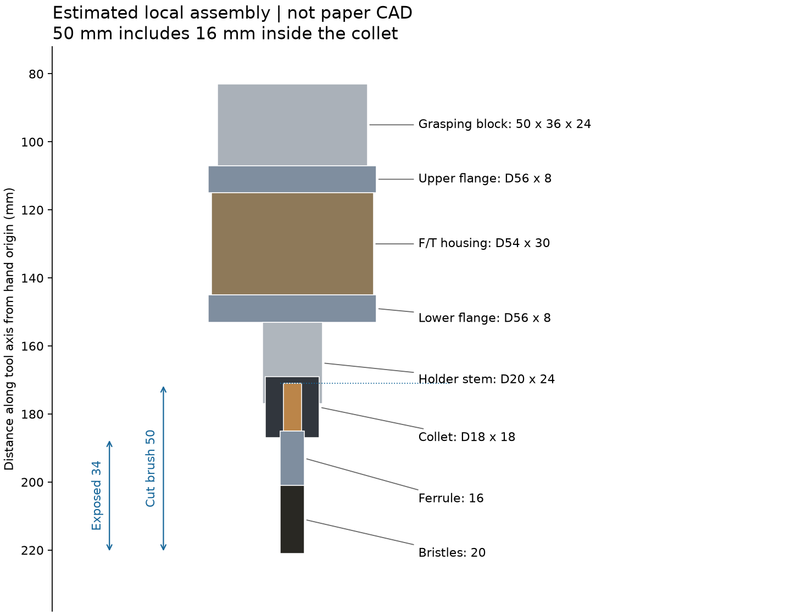
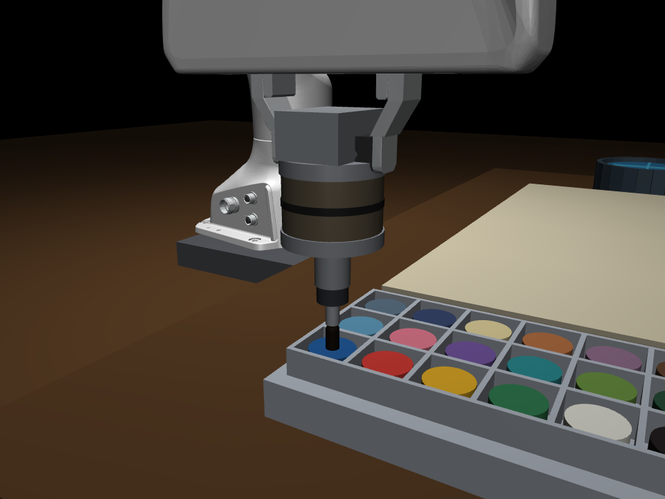
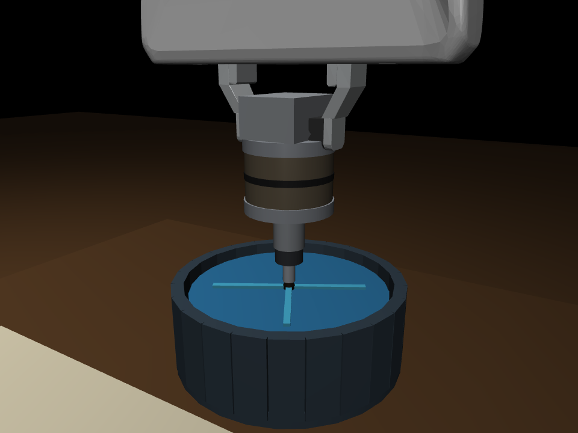

# IMPASTO：短笔装配与工位布局修正

原长杆缺少论文中的安装件，已改为夹持块、上下法兰、F/T 外壳、夹具与短画笔。
论文的“trimmed to 5 cm”按修剪后整笔 50 mm 解释；其中 16 mm 插入夹具，34 mm 外露。
木柄 14 mm、金属箍 16 mm、刷毛 20 mm，传感器外壳约 Φ54×30 mm：这些拆分尺寸均为本地估计。
调色盘与水盆分别放在画布两侧，目标位置从场景几何读取，采用竖直进入与平滑换位。

## 实测验收

|指标|本轮结果|
|---|---:|
|蘸漆 / 清洗实际验证|24 / 24 次，各全部成功|
|工位最大静态 IK 误差|0.049 mm|
|浸入时最大 XY 误差|0.031 mm|
|整个路径最大刷杆倾角|0.957°|
|浸入时最大刷杆倾角|0.0033°|
|超过 0.5 mm 的意外穿透|0|
|单笔 + 多笔绘画|9/9 成功，各笔全程接触|
|9 笔平均力 RMSE|0.022 N|
|9 笔平均力标准差|0.011 N|
|9 笔平均轨迹 RMSE|2.66 mm|
|无录像的仿真 / 墙钟时间比|9.58×|
|4 进程吞吐 / 串行加速|1.32 笔/s / 3.65×|

## 视频

- [8 笔场景视频（含换色与清洗）](../stage1/videos/stage1_scene.mp4)
- [同步顶视视频](../stage1/videos/stage1_topdown.mp4)
- [单笔视频](../stage1/videos/single_stroke_scene.mp4)

## 对齐边界

这些误差来自理想仿真，不代表真实机器人精度。保留 Panda、画布尺寸、24 色槽、顶视观测与附录 A 的工具结构；安装尺寸、质量、工位坐标为本地设计。刷毛使用轴向弹簧近似，颜料为接触驱动沉积模型，水盆无流体仿真。
当前控制仍是关节伺服加连续法向高度反馈，没有完整实现论文式 (4) 的 JᵀF 前馈力矩注入与运笔保持高度策略。原有接触力乘 0.08 的缩放已移除，报告力值是 MuJoCo 未缩放接触力；安装点六维传感器单独保留。
演示是预设笔画，不是学习模型或 MPC 的结果。未验证论文整个 0.1–4 N 工况。物理步长 2 ms，控制周期 4 ms，视频按仿真时间采样，不加速播放。

- [逐项论文核对](../../docs/scene_audit.md)
- [工位与单笔原始数值](metrics.json)
- [力曲线 CSV](force_trace.csv)
- [阶段 1 综合数值](../stage1/metrics.json)
- [阶段 1 完整报告](../stage1/report.md)

复查：`bash scripts/run.sh -m pytest -q`，`bash scripts/run.sh scripts/audit_scene.py`，`bash scripts/run.sh scripts/run_stage1.py`，`bash scripts/run.sh scripts/build_scene_report.py`。
