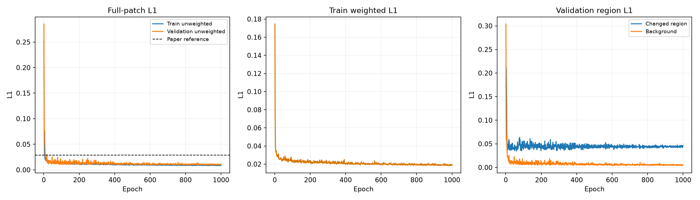
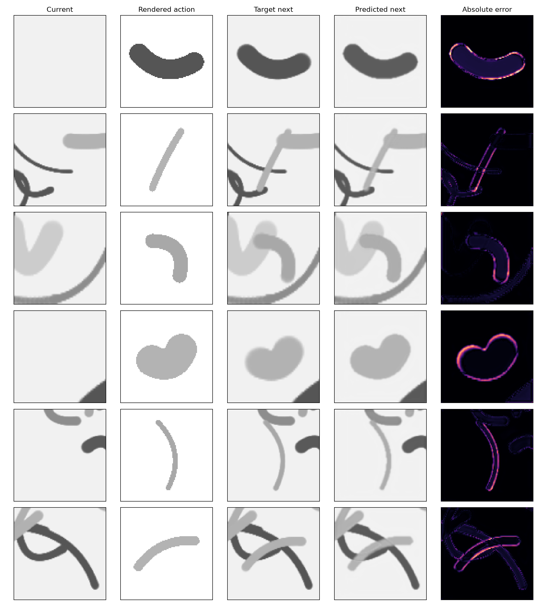

# IMPASTO Stage 2: Pixel Dynamics Evaluation

## Result

The episode-held-out validation set contains 100 transitions from episodes [9]. The best checkpoint is epoch 605; its unweighted next-state L1 is **0.00905**, compared with the paper's **0.0285** reference at 900 training samples. This local simulation score is lower than the reported reference. The same validation set selects the checkpoint, so this is a validation result rather than an untouched test result.

|Metric|Value|
|---|---:|
|Validation unweighted L1|0.00905|
|Changed-region L1|0.04338|
|Background L1|0.00360|
|Paper unweighted L1 reference|0.02850|
|Changed pixels per patch|13.705%|
|Training samples|900|
|Validation samples|100|
|Epochs / batch size|1000 / 120|
|Best epoch|605|
|Training wall time|588.3 s|
|Compute device|NVIDIA GeForce RTX 4090 D|
|Parameter count|999,361|
|U-Net feature widths|[32, 64, 128, 256]|
|Action embedding / fusion level|32 channels / 64-channel encoder level|
|Optimizer|Adam, lr=0.0005, weight decay=0.001|
|Learning-rate decay|x0.75 every 100 epochs|

## Training

## Simulator data quality

The 1,000 successful transitions came from ten independent 100-stroke episodes. Mean achieved force was 1.011 N against a 1.003 N mean target; mean per-stroke force RMSE was 0.024 N (maximum 0.238 N). Mean contact fraction was 0.99964, minimum 0.99005; mean trajectory RMSE was 0.11 mm. Failed attempts averaged 0.093 per accepted sample.

## Reproducibility

Best checkpoint: `outputs/stage2/impasto_unet_best.pt`  
SHA-256: `ba32478044aa68066f2312b88318cd5214dae7cf4468a939fd98509a371ffa7c`  
Training history: `reports/stage2/training_history.csv`  
Dataset manifest: `data/stage2/manifest.json`

The paper-specified model dimensions, optimizer, learning rate, batch size, epoch count, decay schedule, and 900 training samples are used. The signed bend normalization, numeric action limits, crop margin, four-color subset, brush-width law, dropout rate, and changed-pixel loss multiplier are local choices because the paper does not specify them. Inputs use a two-channel 100 x 100 patch and the complete next grayscale patch is predicted. The simulator is the Stage-1 contact-driven paint model, not the real robot; therefore the comparison with the paper is an implementation-level reference, not a controlled reproduction on identical hardware data. No baseline is implemented or evaluated in this stage.
