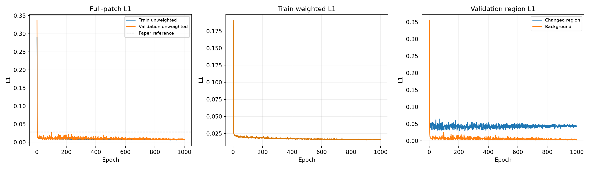
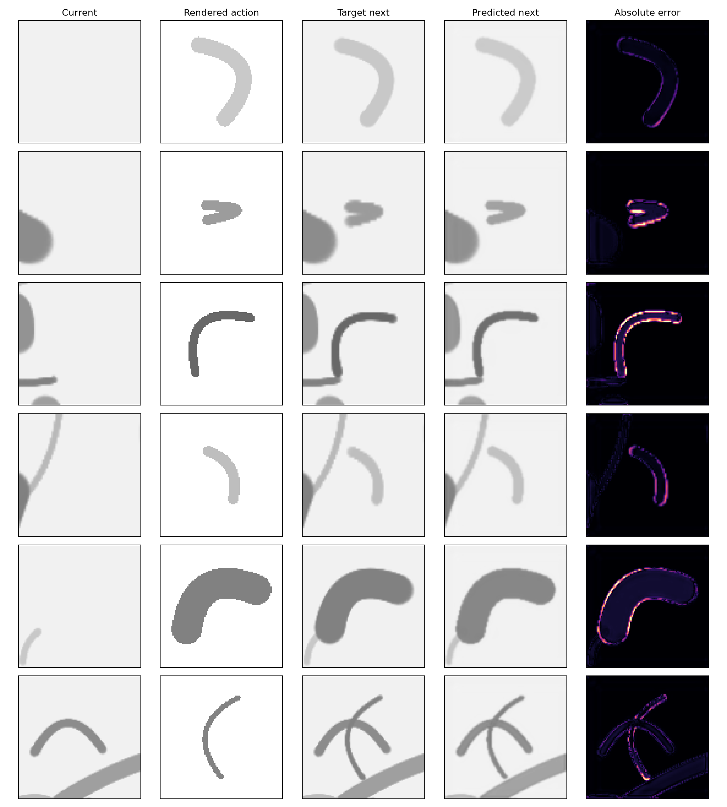

# IMPASTO Stage 2: Pixel Dynamics Evaluation

This page records the **raw** newly trained checkpoint. Deployment calibration and the old/new model comparison are reported in [the complete refinement report](../refinement_coverage_order/index.html) and [the calibration metrics](../model_calibration_audit/metrics.json). The raw model's changed-region error is worse than the old model on the same validation images; its low full-patch error alone does not establish an improvement.

## Result

The episode-held-out validation set contains 200 transitions from episodes [18, 19]. The best checkpoint is epoch 608; its unweighted next-state L1 is **0.00657**, compared with the paper's **0.0285** reference at 900 training samples. These scores use different data and cannot establish superiority to the paper. The same validation set selects the checkpoint, so this is a validation result rather than an untouched test result.

|Metric|Value|
|---|---:|
|Validation unweighted L1|0.00657|
|Changed-region L1|0.03789|
|Background L1|0.00286|
|Paper unweighted L1 reference|0.02850|
|Changed pixels per patch|10.588%|
|Training samples|1800|
|Validation samples|200|
|Epochs / batch size|1000 / 120|
|Best epoch|608|
|Training wall time|1781.0 s|
|Compute device|NVIDIA GeForce RTX 4090 D|
|Parameter count|999,361|
|U-Net feature widths|[32, 64, 128, 256]|
|Action embedding / fusion level|32 channels / 64-channel encoder level|
|Optimizer|Adam, lr=0.0005, weight decay=0.001|
|Learning-rate decay|x0.75 every 100 epochs|

## Training

## Simulator data quality

The 2,000 successful transitions came from 20 independent 100-stroke episodes. Mean achieved force was 0.769 N against a 0.757 N mean target; mean per-stroke force RMSE was 0.021 N (maximum 0.075 N). Mean contact fraction was 1.00000, minimum 1.00000; mean trajectory RMSE was 0.10 mm. Failed attempts averaged 0.047 per accepted sample.

## Reproducibility

Best checkpoint: `outputs/stage2_stable/impasto_unet_best.pt`
SHA-256: `5cee5bbb4ea37e8308e24fa5a28d5b585c8eb4d344b37e1ec4850193d049da34`
Training history: `reports/stage2_stable/training_history.csv`
Dataset manifest: `data/stage2_stable/manifest.json`

The paper-specified model dimensions, optimizer, learning rate, batch size, epoch count, and decay schedule are used. This run uses 1800 training and 200 validation transitions; any increase over 900/100 is a local extension. The signed bend normalization, numeric action limits, crop margin, configured palette, brush-width law, dropout rate, and changed-pixel loss multiplier are local choices because the paper does not specify them. Inputs use a two-channel 100 x 100 patch and the complete next grayscale patch is predicted. The simulator is the Stage-1 contact-driven paint model, not the real robot; therefore the comparison with the paper is an implementation-level reference, not a controlled reproduction on identical hardware data. No baseline is implemented or evaluated in this stage.
