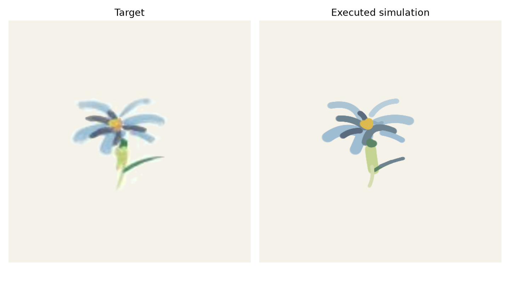
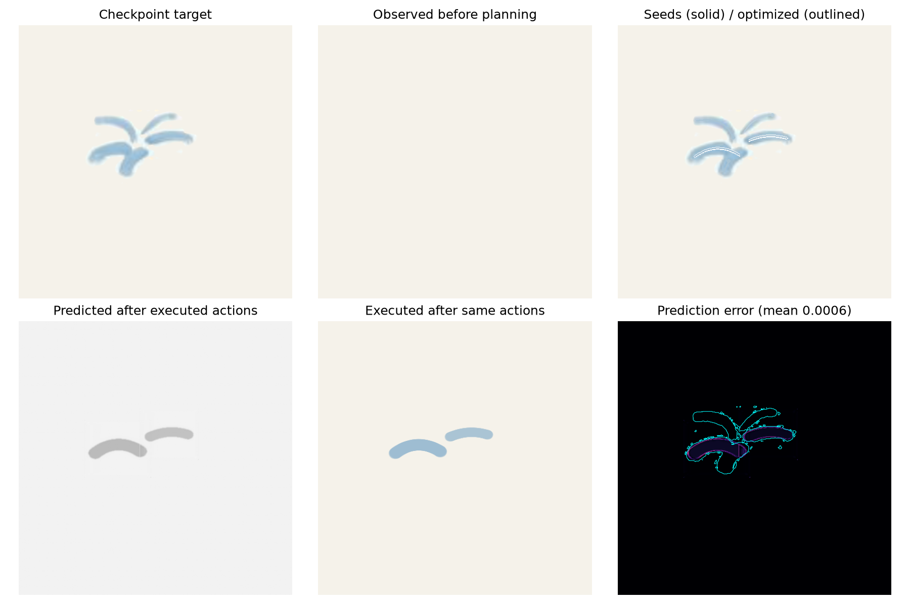
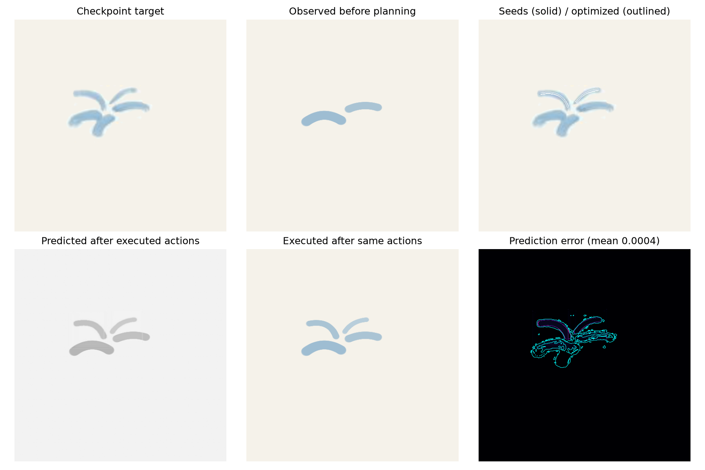
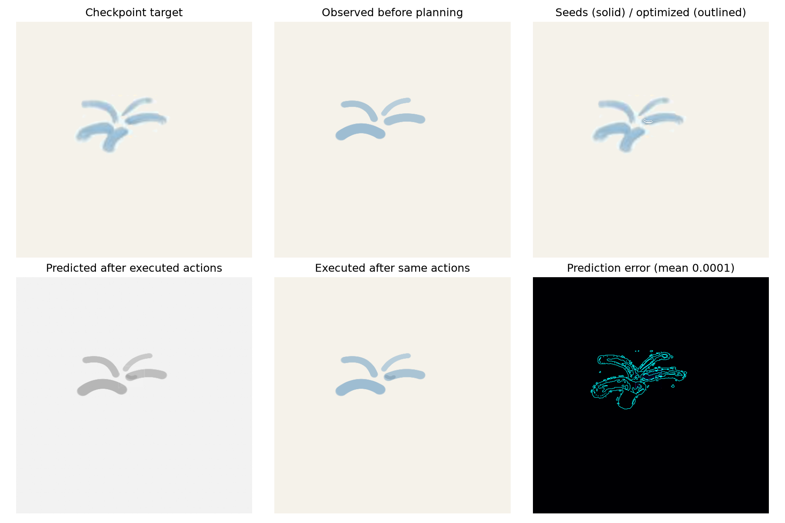
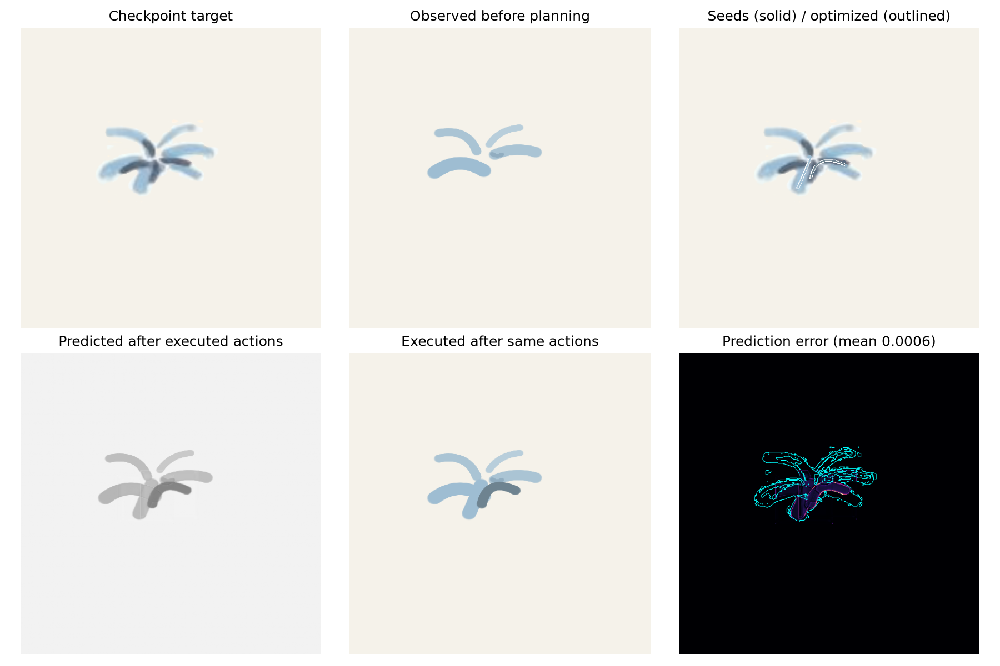
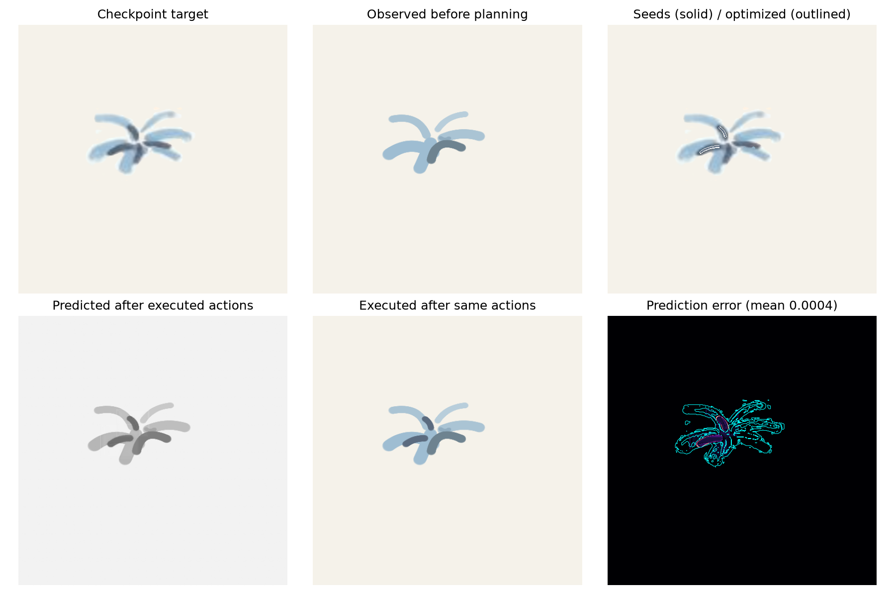
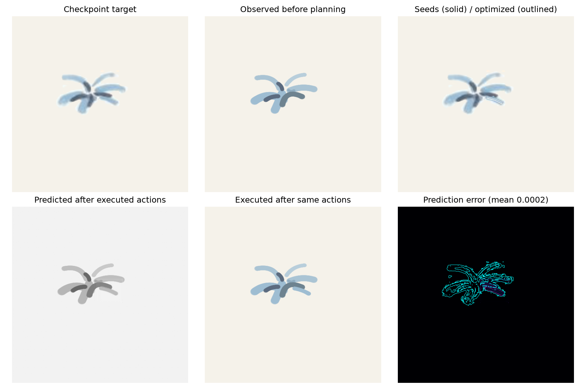
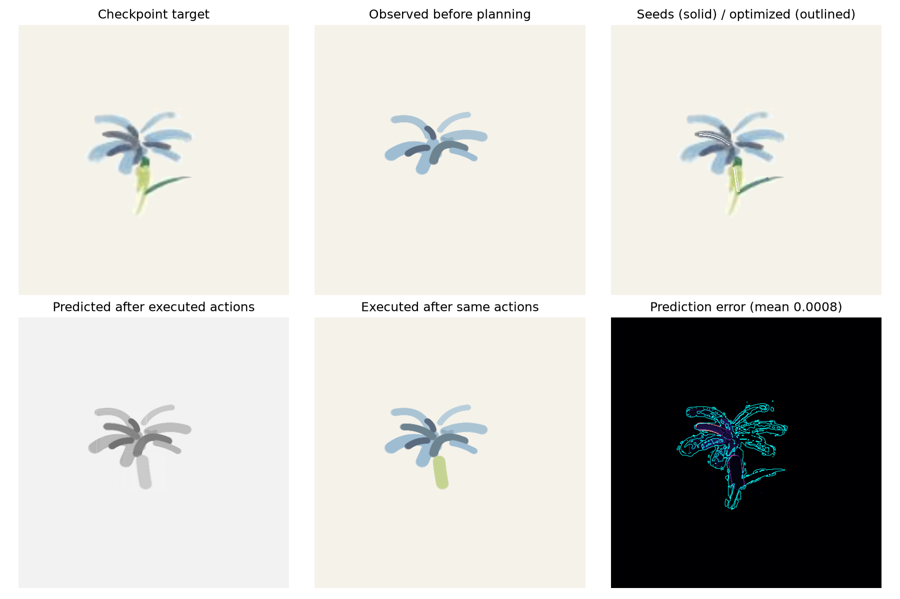
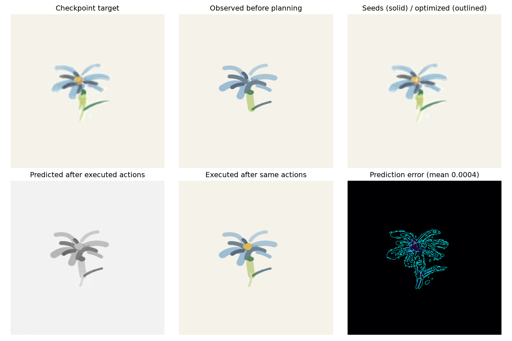

# IMPASTO 阶段三：学习模型驱动的笔画规划

## 结果

规划器使用阶段二训练的 IMPASTO-UNet，按照论文执行 PCA–RANSAC 初始化、加权 L1 终端目标、MPPI elite softmax 序列更新及 CMA 风格进化路径/协方差/步长自适应。多笔绘画采用 H=5，每轮执行 2 笔后读取仿真画布并重新规划。

|任务|目标笔数|执行笔数|规划加权灰度 L1|执行加权灰度 L1|LPIPS AlexNet|
|---|---:|---:|---:|---:|---|
|flower|17|17|0.02186|0.01440|unavailable|

规划 L1 是各重规划周期终端预测误差的均值；执行 L1 是最终真实仿真画布与目标图的误差。完整全画布 L1、改变区域 L1、逐周期代价、每笔力控及轨迹数据见 `metrics.json`。本阶段没有运行或比较任何 baseline。LPIPS could not be initialized: `disabled by default; set IMPASTO_ENABLE_LPIPS=1 after verifying AlexNet weights; a previous download did not pass SHA-256 validation`

## 执行质量

|任务|全部执行成功|法向力 RMSE (N)|轨迹 RMSE (m)|
|---|---:|---:|---:|
|flower|1|0.01101|0.000114|

## 模型预测与实际执行

|任务|执行相同动作后的全画布预测 L1|目标差异区预测 L1|平均透明度 α|
|---|---:|---:|---:|
|flower|0.00040|0.00808|1.000|

此处逐轮比较模型对已执行动作的预测与同一轮真实仿真观测。

## 任务结果

### flower

[Target](flower_target.png) · [Execution video](flower_painting.mp4)

## 论文对齐与边界

- 单笔：H=1，以目标差分初始化并优化笔画参数，再执行该动作并读取真实仿真画布。
- Flower/Fish：保留论文所述 17/18 笔目标规模；目标图和 2/5/7/10/12/15 笔公开检查点来自作者 Fig. 8，使用目标笔数 5、10、15 和最终状态作为窗口目标，H=5，每轮执行两笔并闭环重规划。
- 论文使用的 H=5、每轮两笔及 PCA–RANSAC/MPPI/CMA 规划结构已落实。论文未公开候选数、迭代数、softmax 温度、RANSAC 阈值和 CMA 系数；本地取值见 `configs/stage3_refined.json`。
- 论文没有随文章发布 artist Flower/Fish 的原始高分辨率文件和逐笔颜色/动作。这里使用作者公开 Fig. 8 的低分辨率目标 panel，保留目标笔画数并由规划器推断动作，不冒充原始逐笔标注或定量复刻。
    - 颜色分类使用变化区域 RGB 与本地调色板颜色方向的最小残差，并限制在阶段二采样过的 `[0, 1, 2, 3, 4, 5, 6, 7, 8, 9, 10, 11, 12, 13, 14, 15, 16, 17, 18, 19, 20, 21, 22, 23]`；论文使用带协方差的 25×25 实测颜料 patch 数据库，本地无该数据库。
    - 历史配置曾把附录 B 的分类比值作为连续透明度，并乘本地系数；该做法与真实沉积不等价，修订配置仅使用不透明分支。当前 `opacity_scale=1.000`；不能据此声称实现了论文完整透明度模块。
- 本地阶段一使用 MuJoCo penalty contact 与简化颜料沉积，故执行结果是仿真验证，不等价于真实油画物理或论文硬件试验。
- LPIPS AlexNet 未计算：torchvision 预训练 AlexNet 权重下载未通过 SHA-256 校验；不会以随机网络给出感知指标。

## 可复现文件

- 规划器配置：`configs/stage3_refined.json`
- 聚合数值和逐笔动作/力控日志：`reports/stage3_refined/metrics.json`
- Stage-2 checkpoint SHA-256：`4192beff8dbb7ea7049476d2f481de43990a07f5959c5292abdeb2fc425fa0b9`
- 运行命令：`IMPASTO_STAGE3_CONFIG=configs/stage3_refined.json bash scripts/run.sh scripts/run_stage3.py`

## 逐轮诊断图

### flower

